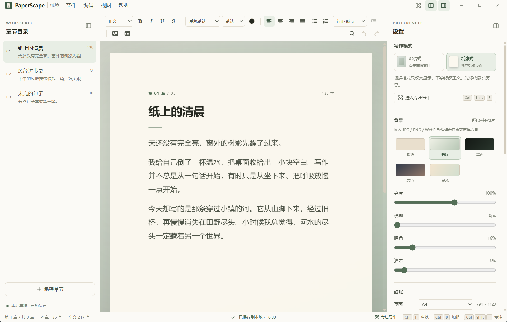
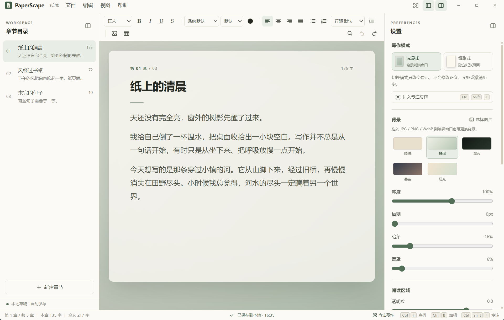
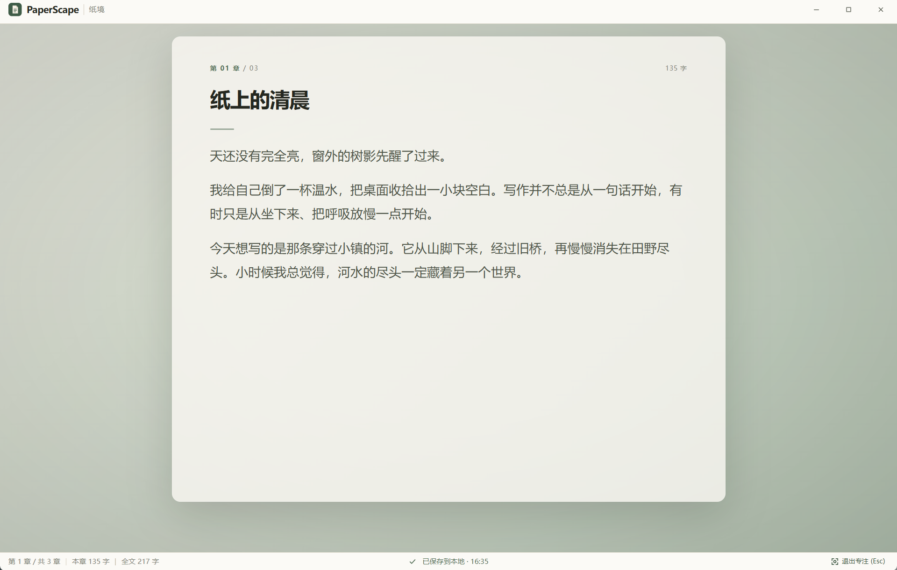

# PaperScape 纸境

一个安静、轻量的 Windows 桌面写作空间。第三阶段加入沉浸式与纸张式双模式、背景管理、专注写作和自定义主题，同时保留已经验证的 Tiptap 富文本编辑与窗口能力。

> 当前版本：0.3.0（第三阶段）
> 技术栈：Tauri 2 + React 19 + Tiptap 3 + TypeScript + Tailwind CSS 4 + Vite 8

## 界面预览

以下截图来自**真实 Tauri 窗口**（Windows 150% DPI）：

| 纸张式 · 独立页面 | 沉浸式 · 背景与阅读区 |
| --- | --- |
|  |  |



## 已完成

### 双模式、背景与专注写作

- 沉浸式：背景铺满编辑区域，正文位于可调透明度的阅读区中。
- 纸张式：背景位于纸张外侧，正文位于独立纸张页面中。
- 背景支持纯色、渐变与自定义 JPG / PNG / WebP 图片。
- 支持把图片直接拖入编辑窗口更换背景，也支持工具栏/设置中的文件选择。
- 背景亮度、模糊、暗角、遮罩、阅读区透明度可调。
- 纸张支持 A4、US Letter、自定义宽度，以及纸张颜色、透明度、阴影和常规/窄/宽/自定义页边距。
- 专注写作：一键隐藏章节目录、设置面板与工具栏，保留正文和底部字数状态；`Ctrl+Shift+F` 或标题栏按钮进入，`Esc` 或状态栏按钮退出。
- 内置 5 套轻量纯色/渐变主题；可保存当前背景、阅读区和纸张设置为自定义主题。
- 自定义主题按 `projectId` 隔离；不同项目会读取各自的主题。
- 背景图片经压缩后存入 IndexedDB，运行时只创建一个 object URL 和一层静态背景，不重复解码大图。
- 只支持静态背景，不加载视频壁纸。

### 桌面与工作区

- 无原生标题栏的标准 Windows 桌面窗口，支持拖动、八方向缩放、最大化、还原、最小化和关闭。
- 窗口按当前显示器的逻辑尺寸自适应并居中，兼容 125% / 150% 等 Windows 缩放比例。
- 三栏布局：左侧章节目录、中间正文编辑区、右侧设置面板，左右面板可折叠。
- 中文优先的菜单、对话框、状态栏和快捷键。
- 浅色 / 深色 / 跟随系统三套外观，配色使用低对比暖纸色。
- 章节新建、切换、本地自动保存，主题、排版与面板状态跨重启持久化。

### Tiptap 富文本编辑器

- 中文、英文与中英混排输入，兼容 Chromium/WebView2 的 IME composition 事件。
- 标题 H1/H2/H3 与普通段落。
- 加粗、斜体、下划线、删除线，支持 `Ctrl+B` / `Ctrl+I` / `Ctrl+U`。
- 字体、字号、文字颜色。
- 左对齐、居中、右对齐、两端对齐；段落行距与首行缩进。
- 有序列表、无序列表。
- 撤销 / 重做，工具栏与中文菜单均接入 Tiptap 历史记录。
- 当前章节与全文实时字数统计。
- 查找与替换：匹配高亮、上一个/下一个、单项替换、全部替换，支持跨行内格式边界匹配。
- 图片插入（本地文件转 Data URL，自动压缩较大图片）与 3×3 表格插入、加行、加列、删除表格。
- 沉浸式阅读区宽度可调（640–980 px）；纸张式使用独立页面宽度。
- 中文标点与中英文混排换行使用 `line-break: strict`、`overflow-wrap` 和 `text-wrap: pretty`。
- 编辑器实例与章节内容通过 `key` 隔离；主题、面板、工具栏状态变化不会重置正在输入的内容。
- 长文性能：`shouldRerenderOnTransaction: false`、工具栏 `useEditorState` 选择性订阅、字数/摘要缓存、400 ms 防抖持久化。

Word 导入导出、云同步和账号系统仍不在本阶段范围内。

## 开发环境

| 工具 | 建议版本 | 检查命令 |
| --- | --- | --- |
| Node.js | 22.12+（已在 24.21 验证） | `node -v` |
| pnpm | 11.x（已在 11.28 验证） | `pnpm -v` |
| Rust | stable MSVC（已在 1.100 验证） | `rustc -V` |
| Visual Studio Build Tools | 2022，含“使用 C++ 的桌面开发” | `cl` |
| Windows SDK | 10.0.26100 或更新 | 检查 `kernel32.lib` |
| WebView2 Runtime | Evergreen | 已随 Windows 11 / Edge 提供 |
| Git | 2.x | `git --version` |

### 安装命令（Windows PowerShell）

```powershell
# Node.js LTS（安装后重开终端）
winget install OpenJS.NodeJS.LTS

# pnpm
corepack enable
corepack prepare pnpm@11 --activate

# Rust MSVC 工具链
winget install Rustlang.Rustup
rustup default stable-msvc

# Visual Studio Build Tools + C++ 桌面开发 + Windows SDK
winget install --id Microsoft.VisualStudio.2022.BuildTools -e --override "--wait --passive --add Microsoft.VisualStudio.Component.VC.Tools.x86.x64 --add Microsoft.VisualStudio.Component.Windows11SDK.26100"

# WebView2（若系统尚无）
winget install Microsoft.EdgeWebView2Runtime
```

安装完成后重新打开终端，确认：

```powershell
node -v
pnpm -v
rustc -V
cargo -V
```

如果 `cargo` 提示找不到 `link.exe`，请从开始菜单打开 **x64 Native Tools Command Prompt for VS 2022**，或先执行 `VsDevCmd.bat -arch=x64`，再运行开发命令。

## 启动与检查

```powershell
pnpm install

# 浏览器中调试界面（无原生窗口）
pnpm dev

# 启动真实 Tauri 桌面窗口（推荐）
pnpm tauri:dev

# TypeScript 检查
pnpm check

# 单元测试
pnpm test

# 生产前端构建
pnpm build

# 生成 Windows 安装包
pnpm tauri:build
```

开发服务器固定使用 `http://localhost:1420`。Tauri 的 `beforeDevCommand` 会自动启动 Vite。

## 项目结构

```text
src/
  App.tsx                 应用状态、章节切换与快捷键
  components/
    TitleBar.tsx          自绘标题栏、菜单入口、面板与窗口按钮
    MenuBar.tsx           中文菜单（编辑菜单接入 Tiptap 命令）
    ResizeHandles.tsx     八方向缩放热区
    ChapterSidebar.tsx    左侧章节目录
    EditorPane.tsx        Tiptap 编辑器生命周期与双模式纸张/阅读区
    EditorToolbar.tsx     富文本工具栏
    FindReplaceBar.tsx    查找与替换
    AppearanceSettings.tsx 写作模式、背景、纸张与自定义主题
    BackgroundLayer.tsx   静态背景、遮罩和暗角
    SettingsPanel.tsx     设置面板
    Dialogs.tsx           快捷键与关于对话框
    StatusBar.tsx         本章/全文字数与专注模式出口
  appearance/
    presets.ts            背景预设、A4/Letter 尺寸、页边距与纸张文字对比
    storage.ts            项目外观 map、主题序列化、IndexedDB 图片
    useAppearance.ts      项目级外观状态、图片导入和主题保存
    useBackgroundImage.ts 背景 object URL 缓存
  editor/
    editorConfig.ts       StarterKit / TextStyleKit / TableKit 等扩展
    image.ts              正文图片读取与压缩
    extensions/
      BlockStyle.ts       段落行距与首行缩进
      SearchHighlight.ts  查找匹配、装饰高亮与替换
  hooks/                  主题、面板、工作区、窗口状态
  lib/
    richText.ts           HTML 文本转换、旧数据迁移与计数
    workspace.ts          本地持久化（v1/v2 → v3 项目外观迁移）
  test/setup.ts           ProseMirror 的 jsdom 布局 API 兼容层
src-tauri/
  src/lib.rs              Tauri 入口与高 DPI 窗口自适应
  tauri.conf.json         无边框窗口与打包配置
  capabilities/           最小窗口权限
```

## 双模式与背景实现说明

- 两种模式使用同一个 `EditorPane` 和同一个 Tiptap 实例，只切换外层 CSS 类、纸张/阅读区样式与面板可见性，不重建编辑器；因此模式切换不会丢失正文、光标或撤销历史。
- 工作区升级为 `version: 3`，包含项目 `projectId`；外观按项目 ID 存取，旧 v1/v2 工作区自动迁移。
- 背景图片在导入时压缩到最大 2560px 并转为 WebP（小图直接保留），存储在 IndexedDB；运行时通过一个 object URL 交给 CSS 背景层，避免 Data URL 进入 localStorage 和重复解码。
- 背景层为静态 DOM 图层：底图/渐变、遮罩、暗角三部分，不使用视频、轮播或每帧动画。
- 纸张文字颜色根据纸张颜色的亮度自动选择深色或浅色，避免深色界面在浅色纸张上出现低对比文字。
- 页面按屏幕宽度缩放到可用区域，不实现 Word 级精确分页；长文在纸张内自然向下滚动。

## 富文本实现说明

- 正文使用真实的 Tiptap 3 / ProseMirror 编辑器，不使用 `contenteditable` 手写替代。
- 章节内容以 Tiptap HTML 保存在 `paperscape.workspace.v1` 中，内部 `version: 2`；旧的纯文本数据会自动转换为段落，不丢失换行。
- 每个章节以 `key={chapter.id}` 挂载独立编辑器。正文更新只写回章节数据，不把 React state 回灌给正在编辑的实例，因此持续输入、主题切换和自动保存不会重置光标。
- 中文字符统计缓存为 `characterCount`，章节摘要缓存为 `excerpt`，长文编辑时侧栏和状态栏无需反复解析 HTML。
- localStorage 写入采用 400 ms 防抖，并在关闭页面时强制 flush。
- 查找匹配支持跨加粗/斜体等行内标记的短语；替换通过 ProseMirror transaction 完成，可撤销。
- 表格使用 TableKit（含列宽拖拽），图片嵌入为 Data URL；大图会缩放到最大 1600 px 并转为 JPEG。
- 中文输入法依赖 ProseMirror 原生 composition 事件处理，应用没有拦截或改写 `compositionstart/update/end`。

## 窗口实现说明

- `decorations: false` 移除系统标题栏，保证界面在 Windows 上一致。
- 标题栏通过 `data-tauri-drag-region` 拖动，双击空白区域切换最大化。
- 无边框窗口的原生缩放边缘在 Windows 上不可靠，因此使用八个透明热区调用 `startResizeDragging`，覆盖四边与四角。
- 最大化状态监听 `onResized`，按钮图标随状态切换；关闭、最小化、最大化均使用 Tauri 窗口 API。
- 启动时读取当前显示器的物理尺寸与缩放比，在 960×640 到 1280×820 逻辑像素之间自适应并居中，避免高 DPI 小屏下窗口超出可用桌面。
- 权限在 `src-tauri/capabilities/default.json` 中显式声明，不使用通配权限。

## 设计约定

- 中文优先；英文只用于品牌和辅助标签。
- 暖纸色背景、低饱和鼠尾草绿强调色，避免高对比和装饰性渐变。
- 双模式共享同一套排版与快捷键；模式只影响显示层，不改变文档内容。
- 不使用连续动画；仅保留面板折叠和背景调节的短过渡，并尊重 `prefers-reduced-motion`。
- 沉浸式阅读区默认 790px，可在 640–980px 之间调整；纸张式使用独立页面宽度。
