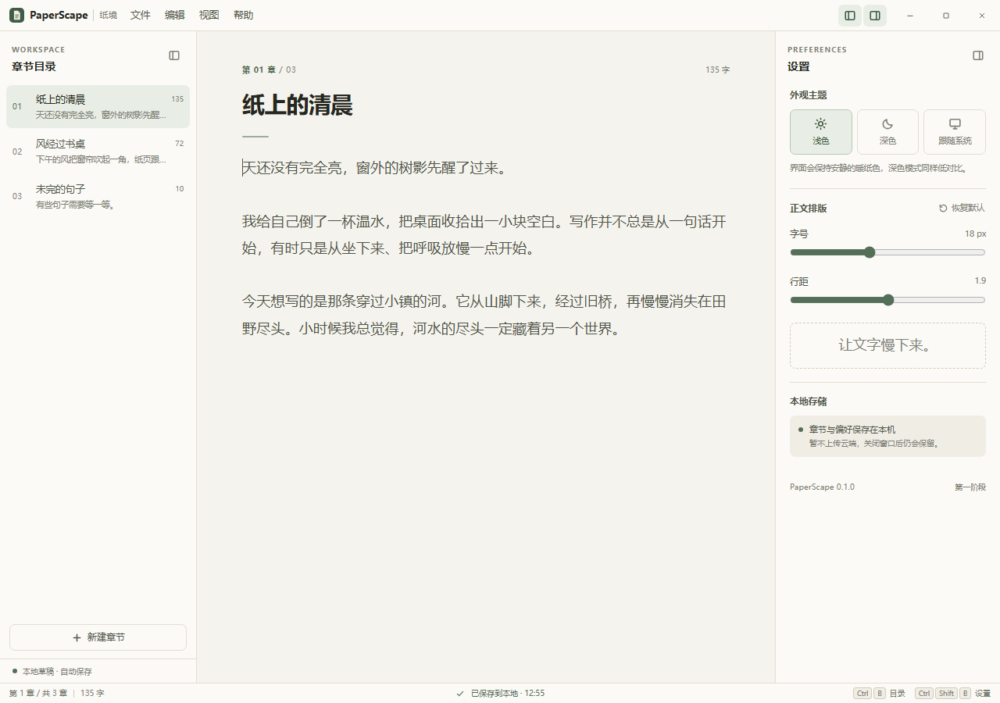
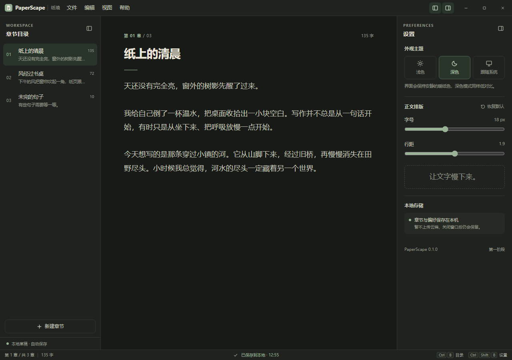
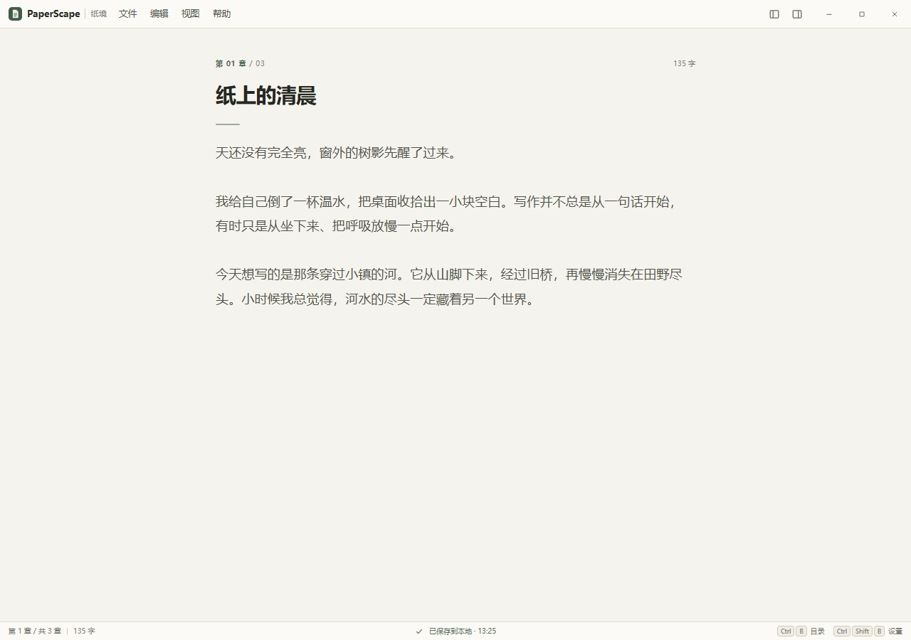

# PaperScape 纸境

一个安静、轻量的 Windows 桌面写作空间。第一阶段聚焦于可靠的桌面窗口、清晰的三栏工作区和舒适的中文写作体验。

> 当前版本：0.1.0（第一阶段）
> 技术栈：Tauri 2 + React 19 + TypeScript + Tailwind CSS 4 + Vite 8

## 界面预览

| 浅色 · 三栏 | 深色 · 三栏 |
| --- | --- |
|  |  |



## 已完成

- 无原生标题栏的标准 Windows 桌面窗口，支持拖动、八方向缩放、最大化、还原、最小化和关闭。
- 三栏布局：左侧章节目录、中间正文编辑区、右侧设置面板。
- 中文优先的菜单、对话框、状态栏和快捷键。
- 浅色 / 深色 / 跟随系统三套外观，配色使用低对比暖纸色。
- 左右面板可折叠，状态与主题、排版偏好持久化到本地。
- 章节的新建、切换、标题与正文编辑，自动保存到本地存储。
- TypeScript 严格检查、Vitest + Testing Library 单元测试。
- 自定义应用图标与 NSIS 打包配置。

本阶段不包含 Word 导入导出、复杂背景系统、云同步或富文本排版。

## 开发环境

| 工具 | 建议版本 | 检查命令 |
| --- | --- | --- |
| Node.js | 22.12+（已在 24.21 验证） | `node -v` |
| pnpm | 11.x（已在 11.28 验证） | `pnpm -v` |
| Rust | stable MSVC（已在 1.100 验证） | `rustc -V` |
| Visual Studio Build Tools | 2022，含“使用 C++ 的桌面开发” | `cl` |
| Windows SDK | 10.0.26100 或更新 | 检查 `kernel32.lib` |
| WebView2 Runtime | Evergreen | 已随 Windows 11 / Edge 提供 |
| Git | 2.x | `git --version` |

### 安装命令（Windows PowerShell）

```powershell
# Node.js LTS（安装后重开终端）
winget install OpenJS.NodeJS.LTS

# pnpm
corepack enable
corepack prepare pnpm@11 --activate

# Rust MSVC 工具链
winget install Rustlang.Rustup
rustup default stable-msvc

# Visual Studio Build Tools + C++ 桌面开发 + Windows SDK
winget install --id Microsoft.VisualStudio.2022.BuildTools -e --override "--wait --passive --add Microsoft.VisualStudio.Component.VC.Tools.x86.x64 --add Microsoft.VisualStudio.Component.Windows11SDK.26100"

# WebView2（若系统尚无）
winget install Microsoft.EdgeWebView2Runtime
```

安装完成后重新打开终端，确认：

```powershell
node -v
pnpm -v
rustc -V
cargo -V
```

如果 `cargo` 提示找不到 `link.exe`，请从开始菜单打开 **x64 Native Tools Command Prompt for VS 2022**，或先执行 `VsDevCmd.bat -arch=x64`，再运行开发命令。

## 启动与检查

```powershell
pnpm install

# 浏览器中调试界面（无原生窗口）
pnpm dev

# 启动真实 Tauri 桌面窗口（推荐）
pnpm tauri:dev

# TypeScript 检查
pnpm check

# 单元测试
pnpm test

# 生产前端构建
pnpm build

# 生成 Windows 安装包
pnpm tauri:build
```

开发服务器固定使用 `http://localhost:1420`。Tauri 的 `beforeDevCommand` 会自动启动 Vite。

## 项目结构

```text
src/
  App.tsx                 应用状态与快捷键
  components/
    TitleBar.tsx          自绘标题栏、菜单入口、面板与窗口按钮
    MenuBar.tsx           中文菜单
    ResizeHandles.tsx     八方向缩放热区
    ChapterSidebar.tsx    左侧章节目录
    EditorPane.tsx        中间编辑区
    SettingsPanel.tsx     右侧设置面板
    Dialogs.tsx           快捷键与关于对话框
    StatusBar.tsx         底部保存与字数状态
  hooks/                  主题、面板、工作区、窗口状态
  lib/window.ts           Tauri 窗口 API 的安全封装
  lib/workspace.ts        本地持久化
src-tauri/
  src/lib.rs              Tauri 入口
  tauri.conf.json         无边框窗口与打包配置
  capabilities/           最小窗口权限
```

## 窗口实现说明

- `decorations: false` 移除系统标题栏，保证界面在 Windows 上一致。
- 标题栏通过 `data-tauri-drag-region` 拖动，双击空白区域切换最大化。
- 无边框窗口的原生缩放边缘在 Windows 上不可靠，因此使用八个透明热区调用 `startResizeDragging`，覆盖四边与四角。
- 最大化状态监听 `onResized`，按钮图标随状态切换；关闭、最小化、最大化均使用 Tauri 窗口 API。
- 权限在 `src-tauri/capabilities/default.json` 中显式声明，不使用通配权限。

## 设计约定

- 中文优先；英文只用于品牌和辅助标签。
- 暖纸色背景、低饱和鼠尾草绿强调色，避免高对比和装饰性渐变。
- 不使用连续动画；仅保留 150ms 的面板折叠过渡，并尊重 `prefers-reduced-motion`。
- 编辑区以内容为中心，最大宽度约 790px，保证长文阅读舒适度。
