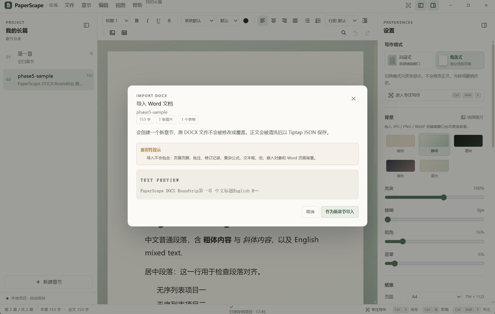
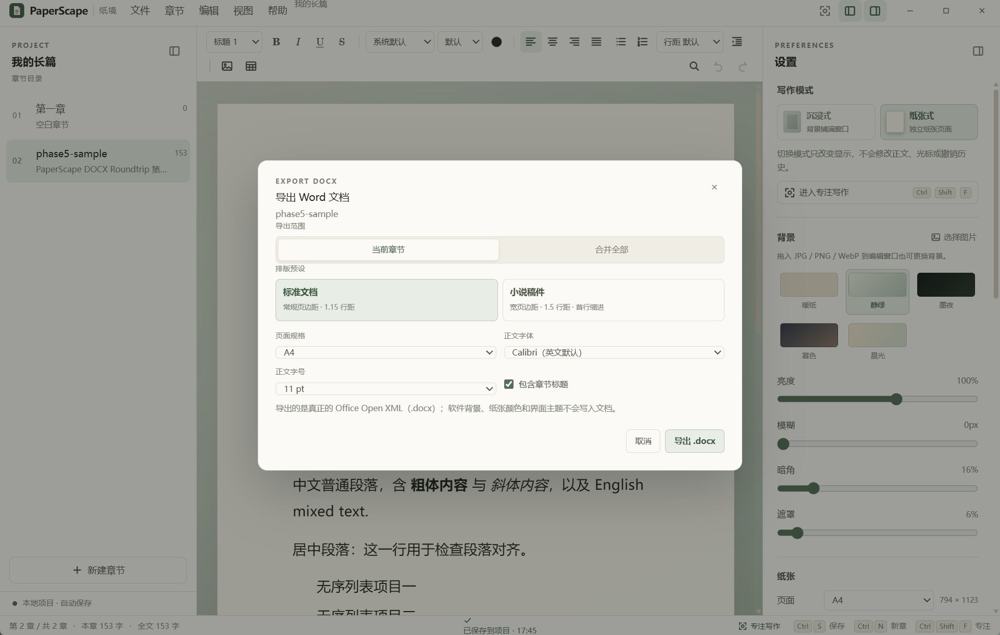

# PaperScape 纸境

一个安静、轻量的 Windows 桌面写作空间。第五阶段实现真正的 Microsoft Word DOCX 导入与导出：Mammoth 解析与安全清洗、Tiptap JSON 中转、真实 Office Open XML 生成，并保留已验证的本地项目与双模式写作能力。

> 当前版本：0.5.0（第五阶段）
> 技术栈：Tauri 2 + React 19 + Tiptap 3 + Mammoth + docx + TypeScript + Vite 8

## 界面预览

以下截图来自**真实 Tauri 窗口**（Windows 150% DPI）：

| Word 导入 | Word 导出 |
| --- | --- |
|  |  |

| 项目启动与最近项目 | 本地项目编辑 |
| --- | --- |
|  |  |

| 纸张式 · 独立页面 | 沉浸式 · 背景与阅读区 |
| --- | --- |
|  |  |


## 已完成

### Word DOCX 导入与导出

- 通过 Windows 原生文件对话框选择 `.docx`；原文件只读，导入创建新章节，不覆盖源文件。
- 使用 Mammoth.js 将 DOCX 转换为语义 HTML，再用 DOMPurify 清洗，最后由 Tiptap schema 生成 JSON。
- 支持普通段落、标题 H1–H3、粗体、斜体、下划线、列表、常规表格和图片。
- 清除脚本、事件处理属性、`javascript:` 链接、外部图片和非安全样式；不执行宏、脚本或外部程序。
- 导入前显示字数、图片数、表格数和兼容性提示；页眉页脚、批注、修订、公式、文本框、宏、嵌入对象会明确告知不会导入。
- 导出当前章节或合并全部章节，生成真正的 Office Open XML `.docx`（ZIP 包含 `[Content_Types].xml` 与 `word/document.xml`）。
- 标准文档 / 小说稿件两种预设；A4 / US Letter；基本字体、字号、标题、列表、段落对齐、行距、首行缩进。
- 图片和表格写入对应 OOXML 结构；软件背景、纸张颜色和界面主题不会写入 Word。
- 导出使用 Windows 原生保存对话框，原子写入目标文件。
- 自动化测试覆盖真实 DOCX 导入、HTML 清洗、当前/全部导出、A4/Letter、图片、表格与导入→导出→再导入 round-trip。
- 使用本机 Microsoft Word 只读打开导出文件验证兼容性。

### 本地项目管理与数据安全

- 新建、打开、保存和关闭本地 `.paperscape` 项目；支持最近项目列表与原生文件夹选择器。
- 项目是独立目录，`project.json` 保存章节索引、项目偏好和背景设置；每章正文保存为独立 `chapters/<id>.json`。
- 正文以 **Tiptap JSON** 为主存储结构，不再以 HTML 作为章节文件。
- 每个章节只有当前编辑的一章加载进编辑器；目录中的标题、摘要和字数来自索引缓存。
- 章节支持新建、重命名、上移/下移、删除；删除先移入项目 `trash` 回收目录，并要求确认。
- 输入停止约 800ms 后自动保存；切换章节、关闭项目、关闭窗口前强制保存。
- 保存采用临时文件 + `sync_all` + 原子 rename；写入前先保存历史版本，失败不会覆盖旧文件。
- 每章保留最近 40 个历史版本，项目元数据保留 30 个备份；提供历史版本查看与恢复。
- 异常退出后，下次打开时检测 `recovery/<章节>.json` 草稿并提供恢复/丢弃；正常关闭会清理草稿。
- `project.json` 损坏时优先从 `project.json.bak`/历史备份恢复，损坏原文件移入 `trash`。
- 项目/章节 JSON 损坏、原子替换、历史恢复、路径穿越和删除限制均有 Rust 测试覆盖。
- 不读写、不覆盖任何原始 Word 文件；项目路径必须是不存在或空目录才能新建。
- 文件访问通过自定义 Tauri 命令限定在项目根目录内，没有启用通用文件系统插件权限。

### 双模式、背景与专注写作

- 沉浸式：背景铺满编辑区域，正文位于可调透明度的阅读区中。
- 纸张式：背景位于纸张外侧，正文位于独立纸张页面中。
- 背景支持纯色、渐变与自定义 JPG / PNG / WebP 图片。
- 支持把图片直接拖入编辑窗口更换背景，也支持工具栏/设置中的文件选择。
- 背景亮度、模糊、暗角、遮罩、阅读区透明度可调。
- 纸张支持 A4、US Letter、自定义宽度，以及纸张颜色、透明度、阴影和常规/窄/宽/自定义页边距。
- 专注写作：一键隐藏章节目录、设置面板与工具栏，保留正文和底部字数状态；`Ctrl+Shift+F` 或标题栏按钮进入，`Esc` 或状态栏按钮退出。
- 内置 5 套轻量纯色/渐变主题；可保存当前背景、阅读区和纸张设置为自定义主题。
- 当前项目的外观保存在 `project.json`；不同项目打开时各自读取自己的外观。
- 背景图片经压缩后存入 IndexedDB，运行时只创建一个 object URL 和一层静态背景，不重复解码大图。
- 只支持静态背景，不加载视频壁纸。

### 桌面与工作区

- 无原生标题栏的标准 Windows 桌面窗口，支持拖动、八方向缩放、最大化、还原、最小化和关闭。
- 窗口按当前显示器的逻辑尺寸自适应并居中，兼容 125% / 150% 等 Windows 缩放比例。
- 三栏布局：左侧章节目录、中间正文编辑区、右侧设置面板，左右面板可折叠。
- 中文优先的菜单、对话框、状态栏和快捷键。
- 浅色 / 深色 / 跟随系统三套外观，配色使用低对比暖纸色。
- 章节新建、切换、重命名、排序、删除与本地项目自动保存；主题、排版与面板状态跨重启持久化。

### Tiptap 富文本编辑器

- 中文、英文与中英混排输入，兼容 Chromium/WebView2 的 IME composition 事件。
- 标题 H1/H2/H3 与普通段落。
- 加粗、斜体、下划线、删除线，支持 `Ctrl+B` / `Ctrl+I` / `Ctrl+U`。
- 字体、字号、文字颜色。
- 左对齐、居中、右对齐、两端对齐；段落行距与首行缩进。
- 有序列表、无序列表。
- 撤销 / 重做，工具栏与中文菜单均接入 Tiptap 历史记录。
- 当前章节与全文实时字数统计。
- 查找与替换：匹配高亮、上一个/下一个、单项替换、全部替换，支持跨行内格式边界匹配。
- 图片插入（本地文件转 Data URL，自动压缩较大图片）与 3×3 表格插入、加行、加列、删除表格。
- 沉浸式阅读区宽度可调（640–980 px）；纸张式使用独立页面宽度。
- 中文标点与中英文混排换行使用 `line-break: strict`、`overflow-wrap` 和 `text-wrap: pretty`。
- 编辑器实例与章节内容通过 `key` 隔离；主题、面板、工具栏状态变化不会重置正在输入的内容。
- 长文性能：`shouldRerenderOnTransaction: false`、工具栏 `useEditorState` 选择性订阅、字数/摘要缓存、800ms 自动保存；只加载当前章节正文。

Word 导入导出、云同步和账号系统仍不在本阶段范围内。

## 开发环境

| 工具 | 建议版本 | 检查命令 |
| --- | --- | --- |
| Node.js | 22.12+（已在 24.21 验证） | `node -v` |
| pnpm | 11.x（已在 11.28 验证） | `pnpm -v` |
| Rust | stable MSVC（已在 1.100 验证） | `rustc -V` |
| Visual Studio Build Tools | 2022，含“使用 C++ 的桌面开发” | `cl` |
| Windows SDK | 10.0.26100 或更新 | 检查 `kernel32.lib` |
| WebView2 Runtime | Evergreen | 已随 Windows 11 / Edge 提供 |
| Git | 2.x | `git --version` |

### 安装命令（Windows PowerShell）

```powershell
# Node.js LTS（安装后重开终端）
winget install OpenJS.NodeJS.LTS

# pnpm
corepack enable
corepack prepare pnpm@11 --activate

# Rust MSVC 工具链
winget install Rustlang.Rustup
rustup default stable-msvc

# Visual Studio Build Tools + C++ 桌面开发 + Windows SDK
winget install --id Microsoft.VisualStudio.2022.BuildTools -e --override "--wait --passive --add Microsoft.VisualStudio.Component.VC.Tools.x86.x64 --add Microsoft.VisualStudio.Component.Windows11SDK.26100"

# WebView2（若系统尚无）
winget install Microsoft.EdgeWebView2Runtime
```

安装完成后重新打开终端，确认：

```powershell
node -v
pnpm -v
rustc -V
cargo -V
```

如果 `cargo` 提示找不到 `link.exe`，请从开始菜单打开 **x64 Native Tools Command Prompt for VS 2022**，或先执行 `VsDevCmd.bat -arch=x64`，再运行开发命令。

## 启动与检查

```powershell
pnpm install

# 浏览器中调试界面（无原生窗口）
pnpm dev

# 启动真实 Tauri 桌面窗口（推荐）
pnpm tauri:dev

# TypeScript 检查
pnpm check

# 单元测试
pnpm test

# Rust 项目存储/原子写入/历史/恢复测试
cargo test --manifest-path src-tauri/Cargo.toml --offline --lib

# 生产前端构建
pnpm build

# 生成 Windows 安装包
pnpm tauri:build
```

开发服务器固定使用 `http://localhost:1420`。Tauri 的 `beforeDevCommand` 会自动启动 Vite。

## 项目结构

```text
src/
  App.tsx                 项目壳、编辑器、对话框与快捷键
  components/
    TitleBar.tsx          自绘标题栏、菜单入口、项目名、面板与窗口按钮
    MenuBar.tsx           文件/章节/编辑/视图/帮助菜单
    ResizeHandles.tsx     八方向缩放热区
    ProjectLauncher.tsx   新建/打开/最近项目与旧草稿导入
    ChapterSidebar.tsx    章节目录、重命名、排序、历史与删除
    EditorPane.tsx        Tiptap 生命周期、JSON 正文与双模式页面
    EditorToolbar.tsx     富文本工具栏
    FindReplaceBar.tsx    查找与替换
    AppearanceSettings.tsx 写作模式、背景、纸张与自定义主题
    BackgroundLayer.tsx   静态背景、遮罩和暗角
    SettingsPanel.tsx     项目外观与排版设置
    HistoryDialog.tsx     章节历史版本恢复
    ConfirmDialog.tsx     删除/丢弃确认
    RenameChapterDialog.tsx 章节重命名
    ImportDocxDialog.tsx  Word 导入预览与兼容性提示
    DocxExportDialog.tsx  Word 导出范围、预设、页面与字体
    Dialogs.tsx           快捷键与关于
    StatusBar.tsx         本章/全文字数、保存状态与专注出口
  docx/
    importDocx.ts         Mammoth 解析、DOMPurify 清洗、Tiptap JSON
    exportDocx.ts         Tiptap JSON → docx Office Open XML
    docx.test.ts          真实 DOCX 导入、导出和 round-trip 测试
  project/
    types.ts              ProjectMeta / ChapterSummary / ChapterFile / OpenProject
    api.ts                Tauri 命令封装与原生文件夹选择
    useProject.ts         项目状态、自动保存、切换、历史、恢复与窗口关闭
    legacy.ts             第三阶段 localStorage 草稿导入
  appearance/
    presets.ts            背景预设、A4/Letter 尺寸、页边距与纸张文字对比
    storage.ts            主题库、IndexedDB 图片与图片压缩
    useProjectAppearance.ts 项目外观控制器
    useBackgroundImage.ts 背景 object URL 缓存
  editor/
    editorConfig.ts       StarterKit / TextStyleKit / TableKit 等扩展
    image.ts              正文图片读取与压缩
    extensions/
      BlockStyle.ts       段落行距与首行缩进
      SearchHighlight.ts  查找匹配、装饰高亮与替换
  hooks/                  主题、面板、窗口状态
  lib/
    richText.ts           旧 HTML 迁移、文本计数
    workspace.ts          第三阶段 localStorage 旧草稿读取
  test/setup.ts           ProseMirror 的 jsdom 布局 API 兼容层
src-tauri/
  src/lib.rs              Tauri 命令、最近项目、原生文件夹选择、窗口
  src/project.rs          项目/章节 JSON、原子写、历史、恢复、回收目录
  tauri.conf.json         无边框窗口与打包配置
  capabilities/           最小窗口权限（无通用 fs 权限）
```

## DOCX 兼容说明

### 导入

- 解析使用 Mammoth.js，只读取用户选择的 `.docx` 字节；不运行宏、不调用 Word、不访问外部资源。
- Mammoth 输出 HTML 后先经 DOMPurify 白名单清洗，再由 Tiptap 扩展生成 JSON。外部图片会被移除，内嵌图片只接受白名单 base64 图片格式。
- 支持：普通段落、标题 H1–H3（H4 映射为 H3）、粗体、斜体、下划线、删除线、有序/无序列表、常规表格、内嵌图片。
- 不支持或可能丢失：页眉页脚、批注、修订记录、公式、文本框、艺术字、SmartArt、嵌入对象、宏、Word 页面背景、分节/分页信息，以及部分复杂段落字体和对齐。
- 导入始终创建新章节；原 DOCX 文件不会被修改。

### 导出

- 使用 `docx` 库生成真正的 ZIP/OOXML，不把 HTML 改扩展名。
- 预设：
  - 标准文档：A4、1 英寸页边距、1.15 行距。
  - 小说稿件：A4、较宽页边距、1.5 行距、首行缩进。
- 页面可选 A4 或 US Letter；正文字体、字号可选；标题、列表、粗体/斜体/下划线/删除线、文字样式、对齐、行距和首行缩进会写入。
- 表格、PNG/JPEG/GIF/BMP 图片会写入；WebP/SVG 等暂不支持的内嵌图片会跳过并在导出后提示。
- 软件背景、纸张颜色、暗角、遮罩和界面主题不会进入 Word。
- 合并全部章节时按章节顺序导出，并在章节之间设置分页。
- 导出文件已在 Microsoft Word 中实际只读打开验证；没有安装 Word 的环境无法完成该类人工兼容性检查。
- 样本与真实导出文件位于 `docs/fixtures/`；生成脚本为 `scripts/make-docx-fixture.py`。

## 本地项目格式与安全

```text
我的长篇.paperscape/
  project.json                 项目 ID、名称、章节顺序、active id、外观、排版
  project.json.bak             最近一次成功写入的元数据副本
  chapters/<chapter-id>.json   单章标题与 Tiptap JSON doc
  history/<chapter-id>/        该章节最近 40 个历史版本
  history/project/             项目元数据最近 30 个备份
  recovery/<chapter-id>.json   异常退出时的恢复草稿；正常关闭会删除
  trash/                       删除的章节/损坏元数据的保留副本
  assets/                      项目资源目录（预留）
```

- 写文件时先写入同目录临时文件，`sync_all` 后原子替换；失败会保留旧文件和临时文件。
- 每次章节保存前备份旧版本；自动保存的历史备份限频，避免长篇项目无限产生副本。
- `sessionClean=false` 表示上次没有正常关闭。打开时若发现更新的 recovery 草稿，会提示恢复或丢弃。
- 删除章节只移动到 `trash/`，UI 必须经过确认；不会直接永久删除。
- 新建项目拒绝已有非空目录，因此不会覆盖其中的 Word 文件。
- Rust 层校验章节 ID、历史文件名和项目根目录，拒绝路径穿越；没有启用通用 `fs` 权限。
- 最近项目保存在应用配置目录的 `recent-projects.json`，只保留仍存在的项目。

## 双模式与背景实现说明

- 两种模式使用同一个 `EditorPane` 和同一个 Tiptap 实例，只切换外层 CSS 类、纸张/阅读区样式与面板可见性，不重建编辑器；因此模式切换不会丢失正文、光标或撤销历史。
- 工作区旧 v1/v2 数据仍保留读取和导入路径；第四阶段项目外观保存在各自 `project.json`，不再依赖 localStorage。
- 背景图片在导入时压缩到最大 2560px 并转为 WebP（小图直接保留），存储在 IndexedDB；运行时通过一个 object URL 交给 CSS 背景层，避免 Data URL 进入 localStorage 和重复解码。
- 背景层为静态 DOM 图层：底图/渐变、遮罩、暗角三部分，不使用视频、轮播或每帧动画。
- 纸张文字颜色根据纸张颜色的亮度自动选择深色或浅色，避免深色界面在浅色纸张上出现低对比文字。
- 页面按屏幕宽度缩放到可用区域，不实现 Word 级精确分页；长文在纸张内自然向下滚动。

## 富文本实现说明

- 正文使用真实的 Tiptap 3 / ProseMirror 编辑器，不使用 `contenteditable` 手写替代。
- 项目章节以 Tiptap JSON 作为主存储；章节文件是独立的 `chapters/<id>.json`，项目索引只保存摘要。
- 每个当前章节以 `key={chapter.id}:{documentRevision}` 挂载独立编辑器，只加载正在编辑的正文；外部恢复历史/草稿时通过 revision 重新挂载。
- 中文字符统计缓存为 `characterCount`，章节摘要缓存为 `excerpt`，长文编辑时侧栏和状态栏无需反复解析章节文件。
- 项目保存采用约 800ms 自动保存、切换章节前强制保存、关闭项目和关闭窗口前强制 flush。
- 查找匹配支持跨加粗/斜体等行内标记的短语；替换通过 ProseMirror transaction 完成，可撤销。
- 表格使用 TableKit（含列宽拖拽），图片嵌入为 Data URL；大图会缩放到最大 1600 px 并转为 JPEG。
- 中文输入法依赖 ProseMirror 原生 composition 事件处理，应用没有拦截或改写 `compositionstart/update/end`。

## 窗口实现说明

- `decorations: false` 移除系统标题栏，保证界面在 Windows 上一致。
- 标题栏通过 `data-tauri-drag-region` 拖动，双击空白区域切换最大化。
- 无边框窗口的原生缩放边缘在 Windows 上不可靠，因此使用八个透明热区调用 `startResizeDragging`，覆盖四边与四角。
- 最大化状态监听 `onResized`，按钮图标随状态切换；关闭、最小化、最大化均使用 Tauri 窗口 API。
- 启动时读取当前显示器的物理尺寸与缩放比，在 960×640 到 1280×820 逻辑像素之间自适应并居中，避免高 DPI 小屏下窗口超出可用桌面。
- 权限在 `src-tauri/capabilities/default.json` 中显式声明，不使用通配权限。

## 设计约定

- 中文优先；英文只用于品牌和辅助标签。
- 暖纸色背景、低饱和鼠尾草绿强调色，避免高对比和装饰性渐变。
- 双模式共享同一套排版与快捷键；模式只影响显示层，不改变文档内容。
- 不使用连续动画；仅保留面板折叠和背景调节的短过渡，并尊重 `prefers-reduced-motion`。
- 沉浸式阅读区默认 790px，可在 640–980px 之间调整；纸张式使用独立页面宽度。
