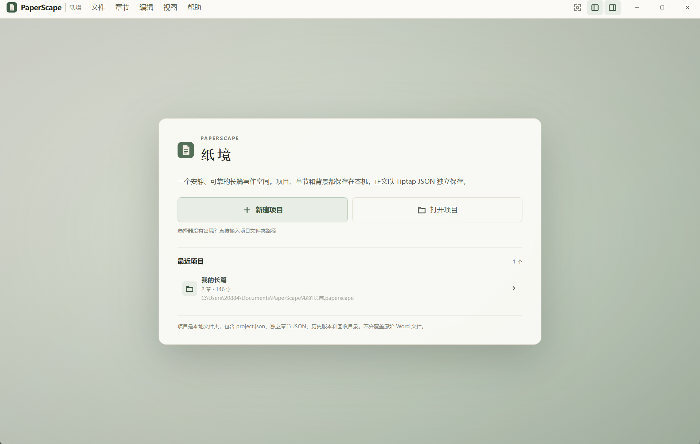
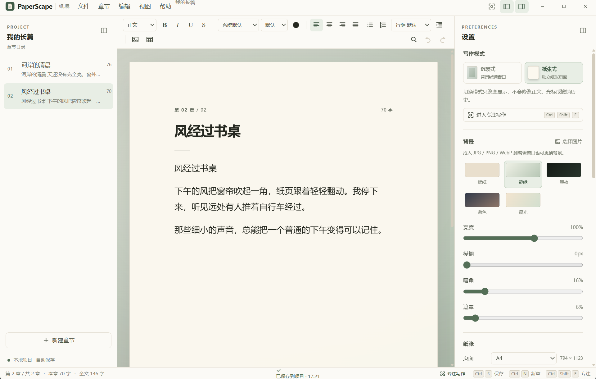

# PaperScape 纸境

PaperScape 是一个安静、轻量的 Windows 桌面长篇写作空间。正文使用 Tiptap 富文本编辑，项目以本地文件夹保存，支持双模式背景、专注写作、完整章节管理，以及真正的 Microsoft Word DOCX 导入/导出。

- **版本：1.0.0（正式版）**
- **安装包：** [PaperScape_1.0.0_x64-setup.exe](release/PaperScape_1.0.0_x64-setup.exe)
- **安装包大小：** 2,383,333 bytes（约 2.27 MiB）
- **签名：** **未签名（NotSigned）**。Windows SmartScreen 可能提示“未知发布者”。
- **WebView2：** 安装包不包含 WebView2，使用 Windows 已有的 Microsoft Edge WebView2 Runtime。

## 安装

1. 运行 `release/PaperScape_1.0.0_x64-setup.exe`。
2. 按安装向导选择安装位置。默认位置为当前用户的 `%LOCALAPPDATA%\PaperScape`。
3. 安装完成后从开始菜单或桌面快捷方式启动。
4. 卸载请使用安装目录中的 `uninstall.exe`，或在 Windows“应用和功能”中卸载。

> 当前安装包没有代码签名。未签名的安装程序在部分 Windows 计算机上会触发 SmartScreen 或安全软件提示；这是预期安全提示，不表示已经签名。
>
> 本仓库的自动化测试环境对默认安装目录有写入限制，因此安装验证使用了自定义目录；详见 [PERFORMANCE.md](PERFORMANCE.md) 和 [KNOWN_ISSUES.md](KNOWN_ISSUES.md)。

## 基本使用

### 新建/打开项目

- 启动页点击“新建项目”，填写项目名称和保存位置。
- 项目是一个 `.paperscape` 文件夹，包含 `project.json`、独立章节 JSON、历史版本、恢复草稿和回收目录。
- 最近项目会显示在启动页；可直接输入 `.paperscape` 文件夹路径打开。

### 写作

- 左侧章节栏可新建、切换、重命名、排序和删除章节。
- 正文自动保存；`Ctrl+S` 立即保存。
- `Ctrl+N` 新建章节，`Ctrl+Shift+F` 进入专注写作。
- 设置面板可切换“纸张式/沉浸式”、背景、字体、字号、行距、纸张颜色和阅读宽度。
- 背景图片支持 JPG/PNG/WebP，单张最大 15 MB；大图会缩放到最长边 2560 px。

### Word 导入

- 菜单“文件 → 导入 Word 文档…”。
- 选择 `.docx` 后先显示导入预览、字数、图片/表格数量和兼容性提示。
- 导入会**创建新章节**，不会修改或覆盖原 Word 文件。
- 支持段落、标题、粗体、斜体、下划线、列表、常规表格和图片。
- 不支持页眉页脚、批注、修订、公式、文本框、宏、嵌入对象等复杂内容；导入时会明确提示。

### Word 导出

- 菜单“文件 → 导出 Word 文档…”。
- 可导出当前章节或合并全部章节。
- 预设：标准文档 / 小说稿件；页面 A4 / US Letter；字体、字号、标题和段落样式可选。
- 导出为真正的 Office Open XML `.docx`，不是 HTML 改扩展名。
- 软件背景、纸张颜色和界面主题不会写入 Word。
- 图片和常规表格会写入；WebP/SVG 等不支持的内嵌图片会跳过并提示。

## 主要功能

- Tiptap 富文本：标题、粗体、斜体、下划线、删除线、列表、引用、代码、链接、表格、图片、对齐和文字颜色。
- 本地项目：原子写入、章节独立 JSON、历史版本、异常恢复、回收目录。
- 双模式：纸张式独立页面、沉浸式铺满窗口。
- 专注模式、可调背景/模糊/暗角/遮罩、纸张宽度/边距/阴影、自定义主题。
- 高 DPI Windows 桌面窗口、无边框标题栏、窗口拖动/缩放/最大化。
- Word DOCX 导入导出，Mammoth + DOMPurify + docx + Tauri 原生文件对话框。

## 界面预览

| Word 导入 | Word 导出 |
| --- | --- |
|  |  |

| 项目启动 | 本地项目 |
| --- | --- |
|  |  |

| 纸张式 | 沉浸式 |
| --- | --- |
|  |  |


## 数据与安全

- 所有正文、章节历史和项目设置保存在用户选择的本地项目文件夹。
- 不依赖云服务；没有遥测、在线同步或后台网络轮询。
- Word 导入不运行宏、脚本或 Word 外部程序；导入 HTML 经 DOMPurify 白名单清洗。
- 导入只读源 `.docx`，始终创建新章节。
- 导出只写入用户选择的文件；软件主题不会进入 Word。
- 详细格式和兼容性限制见 [KNOWN_ISSUES.md](KNOWN_ISSUES.md)。

## 从源码构建

环境：

- Windows 10/11 x64
- Node.js 20+、pnpm 10+
- Rust stable、MSVC x64、Windows SDK
- WebView2 Runtime
- Tauri 2 CLI（项目依赖已包含）

```powershell
pnpm install
pnpm check
pnpm test
pnpm build
pnpm tauri build --bundles nsis
```

> 必须用 `pnpm tauri build` 生成发行版。直接执行 `cargo build --release` 不会启用 Tauri 的 `custom-protocol`，生成的程序会尝试连接 `localhost:1420`，不能作为安装包或便携版分发。

构建产物：

- 主程序：`src-tauri/target/release/paperscape.exe`
- NSIS：`src-tauri/target/release/bundle/nsis/PaperScape_1.0.0_x64-setup.exe`

仓库中已提供最终安装包副本：[release/PaperScape_1.0.0_x64-setup.exe](release/PaperScape_1.0.0_x64-setup.exe)。

### 安装器无法写入时的便携版

如果本机安全策略阻止安装器写入 `%LOCALAPPDATA%`，可使用免安装包：

[release/PaperScape-1.0.0-portable.zip](release/PaperScape-1.0.0-portable.zip)

解压后直接双击 `PaperScape.exe`。便携版不会写入“应用和功能”，卸载时退出程序并删除文件夹即可。

> 早期测试生成的便携版曾误用未启用 `custom-protocol` 的裸 `cargo build --release` 二进制，启动会显示 `localhost` 拒绝连接；该问题已用正式 Tauri 构建修复。当前 `release/PaperScape-1.0.0-portable.zip` 已重新生成并验证启动。

### 测试

```powershell
pnpm check       # TypeScript
pnpm test        # 39 个前端测试
pnpm build       # 前端生产构建
cd src-tauri
cargo test --offline --lib   # 12 个 Rust 测试
cargo build --offline --release
```

测试与实测结果见 [PERFORMANCE.md](PERFORMANCE.md)、[DEVELOPMENT_STATUS.md](DEVELOPMENT_STATUS.md)。

## 目录

```text
src/
  components/      编辑器、章节栏、工具栏、设置、对话框
  editor/          Tiptap 扩展、图片、表格、查找
  project/         项目 API、自动保存、历史/恢复、最近项目
  appearance/      背景和纸张、背景图片存储
  docx/            DOCX 导入、清洗、导出和测试
  App.tsx
src-tauri/
  src/lib.rs       Tauri 命令、窗口、文件对话框
  src/project.rs   项目存储、历史、恢复、原子写入
docs/
  fixtures/        DOCX 测试样本
  screenshots/     真实界面截图
release/
  PaperScape_1.0.0_x64-setup.exe
```

## 已知问题

完整列表见 [KNOWN_ISSUES.md](KNOWN_ISSUES.md)。重点：

- 安装包未签名，SmartScreen 会提示未知发布者。
- 本测试环境的默认安装目录写入被系统策略阻止；安装验证使用自定义目录，详见性能报告。
- 空闲内存实测约 362–438 MB（含 WebView2 子进程），未达到 150 MB 目标。
- 启动目标测量使用系统缓存已热场景，严格冷启动未验证。
- DOCX 复杂格式、WebP/SVG 图片和部分表格特性支持有限。
- 本机未安装 WiX，未生成 MSI。

## 开发记录

- [DEVELOPMENT_STATUS.md](DEVELOPMENT_STATUS.md)：完整阶段、测试、安装和限制记录
- [PERFORMANCE.md](PERFORMANCE.md)：真实性能与打包报告
- [KNOWN_ISSUES.md](KNOWN_ISSUES.md)：已知问题清单
